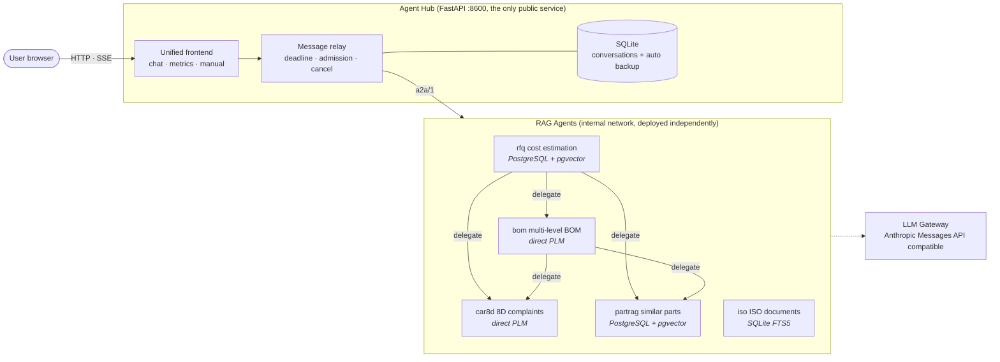
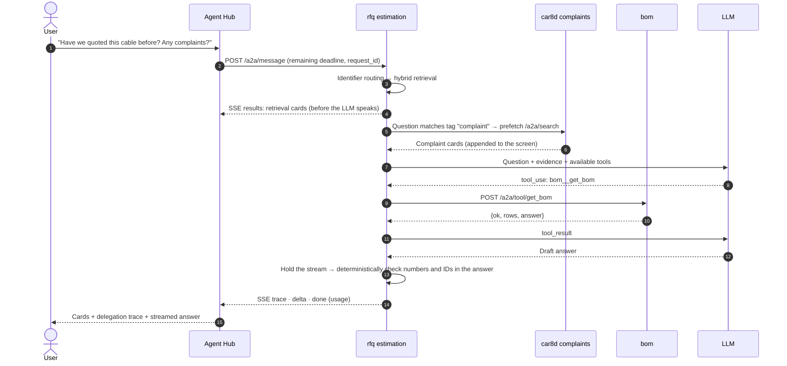
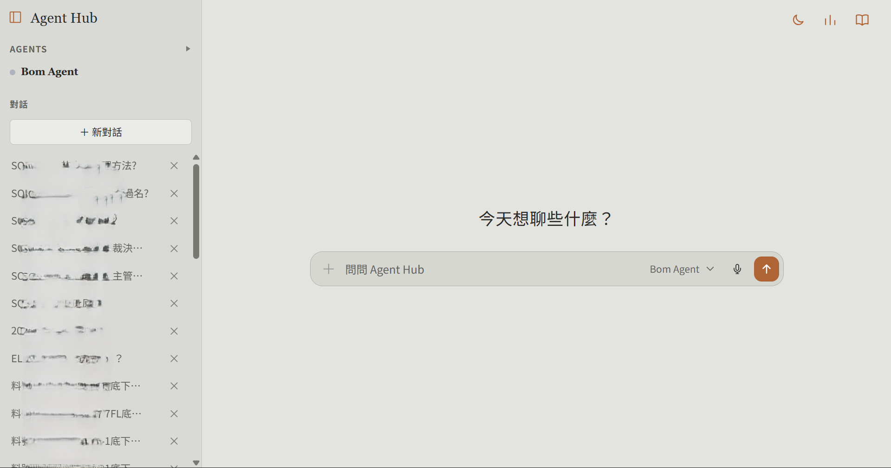

# Agent Hub — Multi-Agent RAG System for Manufacturing

[繁體中文](README.md) | **English**

> **In one sentence**: a single chat window backed by five AI assistants, each owning one slice of data — part numbers, quotations, BOMs, customer complaints, and ISO documents. When a question crosses domains, they ask each other and return an answer that cites its sources and has been checked.

This repo is the **main entry point** of the whole system: the unified frontend, conversation storage, and `agentkit`, the shared framework that lets the agents collaborate.

**System map**: **Agent Hub (this repo)** · [Part-RAG](https://github.com/LiN3simver/Part-RAG) · [RFQ-RAG](https://github.com/LiN3simver/RFQ-RAG) · [BOM-RAG](https://github.com/LiN3simver/Bom-RAG) · [8D-Report-RAG](https://github.com/LiN3simver/8D-Report-RAG) · [ISO-RAG](https://github.com/LiN3simver/ISO-RAG)

> **Portfolio edition**: company data, connection settings, and internal host information have been removed. The agent repositories are private; contact me if you would like access.

---

## Why It Matters

Engineering and sales knowledge in manufacturing is scattered across PLM forms, cost-analysis PDFs, scanned engineering drawings, BOM structures, complaint reports, and ISO documents. Sales digs through past RFQs to quote, R&D checks BOMs and complaint history before swapping a material, QA hunts for procedure clauses — one question often means several systems and several people.

This system connects five independent RAG / data-query services behind one chat interface, focusing on three things:

1. **Pick the retrieval method by data shape instead of dumping everything into a vector store**: hybrid retrieval for short records, attachment tables extracted into rows, read-only live SQL for small real-time data, and clause-level chunking for long documents.
2. **Verifiable answers**: retrieval results reach the screen first, then the LLM answer goes through a deterministic check; if nothing is found, it says so.
3. **Cross-domain collaboration**: e.g. before quoting, the estimation agent automatically asks the complaint agent whether the part has any quality history.

## Repository Guide

| Agent | Repository | Problem solved | Retrieval | Storage |
|---|---|---|---|---|
| Similar parts `partrag` | [Part-RAG](https://github.com/LiN3simver/Part-RAG) | Find the right part among 50k+ near-duplicate part numbers, including drawing material lists | 11-channel hybrid retrieval → RRF → attribute boosting | PostgreSQL + pgvector |
| Cost estimation `rfq` | [RFQ-RAG](https://github.com/LiN3simver/RFQ-RAG) | Look up historical RFQ costs and estimate a cost range with a confidence level for new specs | Identifier routing → 8-channel RRF; k-NN estimation | PostgreSQL + pgvector |
| BOM `bom` | [BOM-RAG](https://github.com/LiN3simver/Bom-RAG) | Expand a product's current multi-level BOM in real time and identify semi-finished goods | Identifier resolution ladder → recursive CTE (no index) | Direct PLM (read-only) |
| 8D complaints `car8d` | [8D-Report-RAG](https://github.com/LiN3simver/8D-Report-RAG) | Query complaint causes, countermeasures, validity rates, and distributions | Question → deterministic filters → read-only SQL (no index) | Direct PLM (read-only) |
| ISO documents `iso` | [ISO-RAG](https://github.com/LiN3simver/ISO-RAG) | Answer questions on ISO procedures with [document · page · clause] citations | Clause chunking → 6-channel RRF incl. BM25 + vectors; adaptive OCR | SQLite (FTS5 + vectors) |

All five agents share the same A2A contract and card format, and every repo's README follows the same sections: overview, core features, architecture, retrieval flow, verification, agent collaboration, technical highlights, measured results, and tech stack.

## Core Features

- **One frontend for all agents**: the frontend reads only the registry and each agent's `/a2a/card`; adding an agent requires no frontend changes
- **Agent-to-agent delegation**: structured tool calls (`<agent>__<tool>`) and natural-language hand-offs (`ask_<agent>`), over a one-way acyclic call graph
- **Delegation requires permission**: "use my own tools" and "ask other agents" are two separate permissions; without permission the model can neither see nor call downstream agents
- **Data first, answer second**: retrieval cards always reach the screen before the LLM is called, so the data is still visible if the LLM fails
- **Graceful degradation**: offline downstreams, unready tools, and LLM disconnects all return structured status — no exceptions, no made-up answers
- **Resource control**: a per-question time budget propagated down every hop, concurrency and queue limits, and a Stop button that cancels all the way to the LLM
- **Observability**: per-question latency, queueing, tool and LLM call counts, and token usage, plus a metrics dashboard

## Architecture



Delegation direction is defined in [`agentkit/registry.py`](agentkit/registry.py): `partrag` and `car8d` are leaf nodes and `iso` is standalone, so calls can never loop back upstream. Only the Hub is exposed; agents are called only on the internal network, and even attachment PDFs are proxied through the Hub.

### How a cross-agent question is handled



### A2A contract (`a2a/1`)

Any FastAPI service becomes an agent by mounting `build_router(AgentSpec)`:

| Endpoint | Purpose |
|---|---|
| `GET /a2a/card` | Card: identity, capabilities, status, who it can call, example questions |
| `GET /a2a/tools` · `POST /a2a/tool/{name}` | Anthropic tool schema; runs a tool and always returns `{"ok": bool, ...}` |
| `POST /a2a/search` | Unified retrieval (no LLM), returns `{hits, raw}` |
| `POST /a2a/message` | Unified chat (SSE): `meta → results → trace* → delta* → error? → done` |
| `GET /a2a/health` · `/a2a/version` | Dependency checks with a hard deadline; agentkit version and source hash |

Card `hits[]` are described with three block types — `kv` / `text` / `table` — so the frontend renders every agent's results with one renderer. `raw` keeps the original rows, and `null` (not filled) and `0` (filled with 0) are never merged anywhere along the way.

### Agent collaboration

| Mechanism | How |
|---|---|
| Two calling styles | `<agent>__<tool>`: structured arguments when you know which record you need; `ask_<agent>`: let the other agent decide, and it can delegate further |
| Cycle prevention | The delegation loop only mounts `downstream` agents from the registry; upstream calls are rejected |
| Two permission gates | Without delegation permission, downstreams don't appear in the tool list or system prompt; even if the model fabricates a tool name, it is rejected before execution |
| Prefetch | Small models often answer without calling tools when "their own results happen to contain part numbers", and prompting can't fix that; instead, deterministically: if the question matches a downstream's `tags`, call its `/a2a/search` first and put the results into the question |
| Loop safeguards | Decide tool execution from `tool_use` blocks in the content (not `stop_reason`); halve the number of rows when a tool result is too long instead of truncating JSON; drop a tool after 2 identical calls; force an answer from gathered data when steps run out; recover tool calls written as JSON in plain text |
| Limits travel with tools | A downstream's data limitations live in `ToolSpec.description` and are passed to the upstream model verbatim, so upstream answers carry those caveats |

## Demo



<sub>Chat home: agent list and conversation history on the left (history titles blurred); the agent switcher and voice input sit to the right of the input box; dark mode, metrics, and manual are at the top right.</sub>

| Page | Content |
|---|---|
| `/` | Chat: switch agents, example questions, voice input, stop, conversation list |
| `/metrics` | Metrics: answer count, failure rate, mean / P95 latency, agent ranking, 10 slowest |
| `/manual` | User manual |

When you ask a question, the screen shows, in order:

1. **Retrieval cards**: delivered before the LLM speaks; query keywords are highlighted so you can tell at a glance whether anything matched
2. **Delegation trace**: which agent and tool were called, arguments, success, and latency; prefetches are labeled "prefetch" rather than model calls
3. **Streamed answer**: streamed token by token; cards appended by downstreams follow, tagged with their source agent

| Example question | Answered by |
|---|---|
| "Which PH2.0 2×3P cables are 300 mm long?" | `partrag` |
| "Roughly what did this spec cost before? Also check for complaints" | `rfq` → prefetch `car8d` |
| "Which semi-finished goods are under this part?" | `bom` |
| "How long must retained samples be kept?" | `iso` |

## Reliability and Observability

| Item | How |
|---|---|
| Per-question time budget | 180 s by default; remaining time is propagated via `X-A2A-Deadline-Ms`, reserving 2 s per hop so the innermost layer expires first and explains why; data already gathered is kept on timeout |
| Admission control | Hub: 10 concurrent questions, 8 queued; agent retrieval: 4; LLM: 2 per process. When full, returns `busy` rather than treating it as a failure |
| Cancellation | Browser disconnects → Hub cancels the stream → agent closes the LLM request and downstream calls, and starts no new calls |
| Health checks | 2.5 s hard deadline + cache, single-flight so checks don't pile up when a database hangs |
| Observability | Per-turn `request_id`, total latency, time to first card and first token, queueing, tool and LLM calls, token usage; unreported usage is recorded as `null`, not 0; metrics never include questions, answers, or tool arguments |
| Conversation storage | SQLite (WAL), online backup + verification every 24 h, 14 copies kept; corrupted files are quarantined automatically. Sessions are isolated with an httponly cookie (not a login system) |
| Version consistency | Each agent image bundles an agentkit snapshot and reports its source SHA-256 on startup; `check_deployment.py` compares all services and exits 1 on mismatch |
| Deployment | `git push` to the server, which rebuilds / restarts based on changed files; the current image is tagged before each build, and a failed health check rolls back automatically |

## Tech Stack

| Category | Used |
|---|---|
| Services | Python 3.12, FastAPI, Uvicorn, SSE |
| Frontend | Vanilla HTML / CSS / JavaScript (no framework, no build step) |
| LLM | Anthropic SDK against an Anthropic Messages API–compatible LLM gateway; tool-use delegation loop |
| Retrieval | PostgreSQL + pgvector (HNSW), pg_trgm, tsvector, SQLite FTS5, BAAI/bge-m3 (ONNX, CPU) |
| Document processing | RapidOCR, pdfplumber, pypdfium2, OpenCV, OpenCC |
| Data sources | PLM (SQL Server, read-only), cost-analysis PDFs, engineering drawings, ISO documents |
| Deployment & quality | Docker Compose, git-push deployment + auto rollback, pytest, hash-pinned dependency locks (Windows / Linux) |

## Measured Results

| Scope | Result |
|---|---|
| System | 5 RAG agents, 4 retrieval strategies, one frontend; 189 automated Hub tests (offline, ~17 s) |
| Part-RAG | 100% retrieval hit rate across 136 question phrasings; 99.3% answer accuracy |
| RFQ-RAG | 84% of high-confidence estimates within 2× of actual cost; API image 2.66 GB → ~541 MB |
| BOM-RAG | Largest single BOM ~1,500 rows, expanded in ~0.06 s |
| 8D-Report-RAG | Full table scan ~12 ms; 81 selftest assertions + 64 API smoke tests |
| ISO-RAG | Accuracy on simulated OCR degradation 84.5% → 93.2%; 37 unit tests |

> Agent figures were measured on the original system with internal data; the portfolio edition contains no data and cannot reproduce them. Hub tests can be run directly in this repo.

## My Contributions

- **System design**: defined the `a2a/1` contract and the `agentkit` framework (cards, tools, hit cards, SSE event order) so five independent services plug in through one interface and delegate to each other
- **End-to-end implementation of all five agents**: data pipelines, retrieval, answer verification, A2A wrapping, and deployment
- **Retrieval strategy chosen by data shape**: measured corpus structure before designing — hybrid retrieval, attachment table extraction, live SQL, and clause chunking
- **Anti-hallucination**: deterministic fact checking instead of LLM-as-judge, with rejection-and-rewrite, fallback output, and a lessons-learned library of failures
- **Production-grade operations**: deadline propagation, admission control, end-to-end cancellation, observability, version consistency checks, git-push deployment with auto rollback

## Quick Start

```bash
python -m venv .venv
.venv/Scripts/python -m pip install -r requirements.txt     # macOS/Linux: .venv/bin/python
cp .env.example .env                                         # fill in the LLM gateway URL, key, and model
.venv/Scripts/python -m uvicorn main:app --host 127.0.0.1 --port 8600
```

Open <http://127.0.0.1:8600>. The Hub opens even with no agents running; each agent shows as "not started". Agent URLs default to `http://127.0.0.1:<port in registry>` and can be overridden with `A2A_<ID>_URL`.

```bash
# Docker
docker network create ragnet            # first time only
docker compose up --build -d

# Tests (no network, LLM, or agents required)
.venv/Scripts/python -m pip install -r requirements-dev.txt
.venv/Scripts/python -m pytest
```

### Turning a service into an agent

```python
from fastapi import FastAPI
from agentkit import AgentSpec, Hit, ToolSpec, build_router, tool_ok

SPEC = AgentSpec(
    agent_id="my_agent",                      # must exist in agentkit/registry.py
    system="You are ... (state this data's scope and limitations clearly)",
    search_fn=lambda query, top_k, filters: {"results": my_db.search(query, top_k)},
    hits_fn=lambda found: [Hit(id=r["id"], title=r["name"], raw=r) for r in found["results"]],
    tools=[ToolSpec(name="get_item", description="Fetch one full record by id",
                    input_schema={"type": "object", "properties": {"id": {"type": "string"}},
                                  "required": ["id"]},
                    handler=lambda args: tool_ok(my_db.get(args["id"])))],
)

app = FastAPI()
app.include_router(build_router(SPEC))       # serves /a2a/card, /a2a/search, /a2a/message ...
```

Add an `AgentRef` (id, port, upstream/downstream, tags) to the registry and restart the Hub and upstream agents — no frontend changes needed.

## Project Structure

```
├── main.py              Hub API: relay, conversations, health checks, metrics
├── store.py             Conversation storage (SQLite, auto backup and verification)
├── metrics.py           Aggregation for the metrics dashboard
├── agentkit/            Shared A2A framework
│   ├── registry.py      id / port / upstream / downstream / tags for every agent
│   ├── server.py        AgentSpec and /a2a/* routes
│   ├── client.py        Calling other agents (card, search, tools, streaming)
│   ├── delegate.py      Tool / delegation loop, prefetch
│   ├── gateway.py       LLM gateway client and failure diagnosis
│   └── …                Deadlines, admission control, cancellation, telemetry, version checks
├── static/              Frontend (chat, manual, metrics)
├── scripts/             Version checks, agentkit packaging, dependency locking
├── deploy/              git-push deployment scripts
└── tests/               Tests (no network, LLM, or agents required)
```

For design details, the full endpoint list, and environment variables, see [docs/ARCHITECTURE.en.md](docs/ARCHITECTURE.en.md); for deployment, see [deploy/README.en.md](deploy/README.en.md).
