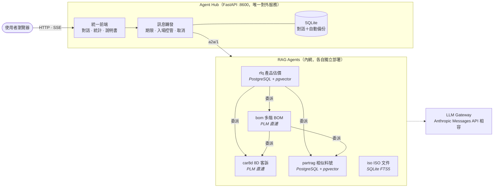
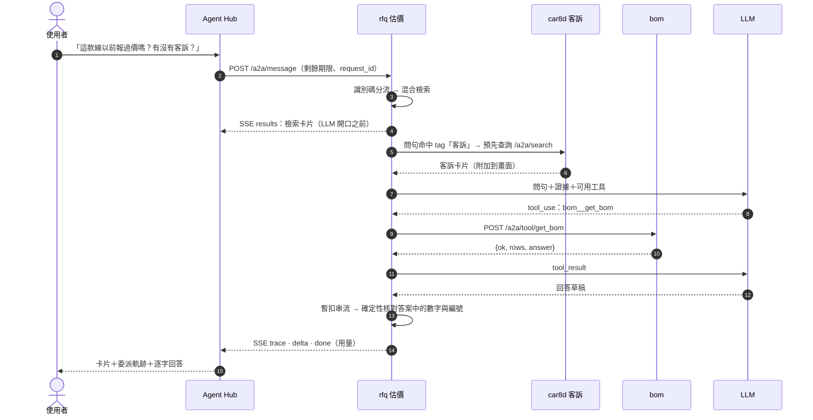
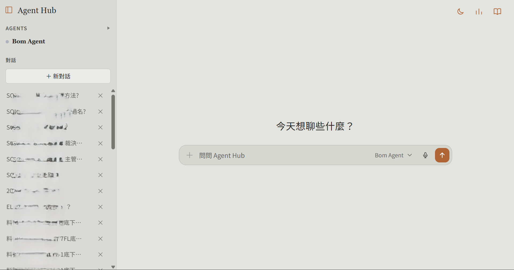

# Agent Hub — 製造業多 Agent RAG 系統

**繁體中文** | [English](README.en.md)

> **一句話介紹**：一個聊天視窗，背後有五個各管一塊資料的 AI 助理——料號、報價、BOM、客訴、ISO 文件；遇到跨領域的問題，它們會互相詢問，最後給出附出處、經過核對的答案。

本 repo 是整套系統的**主入口**：統一前端、對話保存，以及讓各 Agent 互相協作的共用框架 `agentkit`。

**系統導覽**：**Agent Hub（本 repo）** · [Part-RAG](https://github.com/LiN3simver/Part-RAG) · [RFQ-RAG](https://github.com/LiN3simver/RFQ-RAG) · [BOM-RAG](https://github.com/LiN3simver/Bom-RAG) · [8D-Report-RAG](https://github.com/LiN3simver/8D-Report-RAG) · [ISO-RAG](https://github.com/LiN3simver/ISO-RAG)

> **作品集展示版**：不含公司資料、連線設定與內部主機資訊。各 Agent repository 為私人 repo，如需檢閱請聯繫我開通權限。

---

## 專案價值

製造業的工程與業務知識分散在 PLM 表單、成本分析 PDF、掃描工程圖、BOM 結構、客訴單與 ISO 文件裡。業務報價要翻歷史詢價單、RD 換料要查 BOM 與客訴紀錄、品保要找程序文件條文——同一個問題常常要跨好幾個系統、問好幾個人。

這套系統把五個獨立的 RAG／資料查詢服務接成同一個對話介面，重點在三件事：

1. **依資料特性選檢索方式，而不是全部塞進向量庫**：短紀錄用混合檢索、附件表格抽成資料列、小量即時資料直接下唯讀 SQL、長文件依條文切段。
2. **答案可核對**：檢索結果先送到畫面，LLM 的回答再經確定性核對；查不到就說查不到。
3. **跨領域協作**：例如估價 Agent 報價前，自動詢問客訴 Agent 這顆料有沒有品質紀錄。

## Repository 導覽

| Agent | Repository | 解決的問題 | 檢索方式 | 資料儲存 |
|---|---|---|---|---|
| 相似料號 `partrag` | [Part-RAG](https://github.com/LiN3simver/Part-RAG) | 在 5 萬+ 筆近重複料號中找出正確的那一顆，含工程圖材料表 | 11 通道混合檢索 → RRF → 屬性加權 | PostgreSQL + pgvector |
| 產品估價 `rfq` | [RFQ-RAG](https://github.com/LiN3simver/RFQ-RAG) | 查歷史詢價單成本，估出新規格的成本區間與信心等級 | 識別碼分流 → 8 通道 RRF；k-NN 估價 | PostgreSQL + pgvector |
| BOM `bom` | [BOM-RAG](https://github.com/LiN3simver/Bom-RAG) | 即時展開產品現行多階 BOM、判定半成品 | 識別碼解析梯 → 遞迴 CTE（不建索引） | PLM 直連（唯讀） |
| 8D 客訴 `car8d` | [8D-Report-RAG](https://github.com/LiN3simver/8D-Report-RAG) | 查客訴單的原因、對策、成立率與分布 | 問句 → 確定性過濾器 → 唯讀 SQL（不建索引） | PLM 直連（唯讀） |
| ISO 文件 `iso` | [ISO-RAG](https://github.com/LiN3simver/ISO-RAG) | 問 ISO 程序文件，答案附【文件 頁碼 條文】 | 條文切段 → BM25＋向量等 6 通道 RRF；自適應 OCR | SQLite（FTS5＋向量） |

五個 Agent 共用同一套 A2A 契約與卡片格式，各 repo 的 README 採相同章節：專案概覽、核心功能、系統架構、檢索流程、驗證機制、Agent 協作、技術重點、量化成果、技術堆疊。

## 核心功能

- **一個前端管全部 Agent**：前端只讀 registry 與各 Agent 的 `/a2a/card`；新增 Agent 不必改前端
- **Agent 互相委派**：結構化工具呼叫（`<agent>__<tool>`）與自然語言轉問（`ask_<agent>`），呼叫圖單向無環
- **委派需授權**：「用自己的工具」與「詢問其他 Agent」是兩種獨立授權；未授權時模型既看不到、也叫不動下游
- **先給資料、再給答案**：檢索卡片一定在呼叫 LLM 之前送到畫面，LLM 故障時仍看得到資料
- **優雅降級**：下游離線、工具未就緒、LLM 斷線都回結構化狀態，不拋例外、不捏造答案
- **資源可控**：整題時間預算逐層往下傳、併發與排隊上限、按「停止」會一路取消到 LLM
- **可觀測**：每題耗時、排隊、工具與 LLM 呼叫次數、token 用量，附統計總覽頁

## 系統架構



委派方向定義在 [`agentkit/registry.py`](agentkit/registry.py)：`partrag`、`car8d` 是葉節點，`iso` 是獨立節點，不可能繞回上游。只有 Hub 對外開放，各 Agent 只在內網被呼叫，連附件 PDF 都由 Hub 代理。

### 一個跨 Agent 問題的處理流程



### A2A 契約（`a2a/1`）

任何 FastAPI 服務掛上 `build_router(AgentSpec)` 就成為 Agent：

| 端點 | 用途 |
|---|---|
| `GET /a2a/card` | 名片：身分、能力、狀態、可呼叫誰、範例問句 |
| `GET /a2a/tools` · `POST /a2a/tool/{name}` | Anthropic tool schema；執行工具，固定回 `{"ok": bool, ...}` |
| `POST /a2a/search` | 統一檢索（不經 LLM），回 `{hits, raw}` |
| `POST /a2a/message` | 統一對話（SSE）：`meta → results → trace* → delta* → error? → done` |
| `GET /a2a/health` · `/a2a/version` | 有硬期限的依賴檢查；agentkit 版本與原始碼雜湊 |

卡片 `hits[]` 以 `kv`／`text`／`table` 三種 block 描述，前端用同一套渲染畫所有 Agent 的結果；`raw` 保留原始資料列，`null`（未填）與 `0`（填了 0）全程不合併。

### Agent 協作機制

| 機制 | 做法 |
|---|---|
| 兩種呼叫方式 | `<agent>__<tool>`：知道要哪筆資料時用結構化參數；`ask_<agent>`：交給對方判斷，對方還能再往下問 |
| 防環 | 委派迴圈只掛 registry 中的 `downstream`，往上游呼叫會被拒絕 |
| 兩道授權 | 未允許委派時，下游不出現在工具清單與 system prompt；即使模型硬湊出工具名，執行前也會被拒絕 |
| 預先查詢 | 小型模型常在「自己的結果碰巧有料號」時不呼叫工具就作答，這無法靠提示詞修正；改為確定性做法：問句命中下游的 `tags` 就先打對方 `/a2a/search`，把結果放進問句 |
| 迴圈保護 | 依 content 中的 `tool_use` block 判斷是否執行（不信 `stop_reason`）；工具結果過長時折半刪筆數而非截斷 JSON；同參數重複呼叫 2 次即收回該工具；步數用完強制以已取得的資料作答；從純文字中救回被寫成 JSON 的工具呼叫 |
| 限制隨工具傳遞 | 下游的資料限制寫在 `ToolSpec.description`，原樣掛給上游模型，上游的回答因此自帶限制說明 |

## Demo



<sub>對話首頁：左側為 Agent 清單與對話紀錄（紀錄標題已模糊處理），輸入框右側可切換 Agent、語音輸入；右上角為深色模式、統計總覽與說明書。</sub>

| 頁面 | 內容 |
|---|---|
| `/` | 對話頁：切換 Agent、範例問句、語音輸入、停止、對話清單 |
| `/metrics` | 統計總覽：回答數、失敗率、平均／P95 耗時、Agent 排行、最慢 10 筆 |
| `/manual` | 使用說明書 |

問一題時畫面依序出現：

1. **檢索卡片**：在 LLM 開口之前送達；問句關鍵字在卡片中標色，掃一眼就知道有沒有查到
2. **委派軌跡**：呼叫了哪個 Agent、哪支工具、參數、成功與否、耗時；預先查詢標為「預先查詢」而非模型呼叫
3. **逐字回答**：串流送達；下游追加的卡片接在後面並標上來源 Agent

| 範例問句 | 由誰回答 |
|---|---|
| 「PH2.0 2*3P、長 300mm 的線有哪些？」 | `partrag` |
| 「這個規格以前大概多少錢？順便看有沒有客訴」 | `rfq` → 預先查詢 `car8d` |
| 「這顆料底下有哪些半成品？」 | `bom` |
| 「留樣品要保存多久？」 | `iso` |

## 可靠性與可觀測性

| 項目 | 做法 |
|---|---|
| 整題時間預算 | 預設 180 秒，以 `X-A2A-Deadline-Ms` 把剩餘時間往下傳，每過一層預扣 2 秒，讓最內層先到期並說明原因；到期時已取得的資料保留 |
| 入場控管 | Hub 同時 10 題、排隊 8 題；Agent 檢索 4 筆；LLM 每 process 2 份。滿載回 `busy`，不當成故障 |
| 取消 | 瀏覽器中斷 → Hub 取消串流 → Agent 關閉 LLM 請求與下游呼叫，之後不再發起新呼叫 |
| 健康檢查 | 2.5 秒硬期限＋快取，single-flight 避免資料庫卡住時檢查越積越多 |
| 觀測 | 每輪 `request_id`、總耗時、首張卡片與首字時間、排隊、工具與 LLM 呼叫、token 用量；未回報的用量記為 `null` 而非 0；統計不含問題、答案或工具參數 |
| 對話保存 | SQLite（WAL），每 24 小時線上備份並驗證、保留 14 份；損壞檔自動隔離。session 以 httponly cookie 隔離（非登入機制） |
| 版本一致性 | 各 Agent image 內含 agentkit 快照，啟動時回報原始碼 SHA-256；`check_deployment.py` 比對全部服務，不一致即 exit 1 |
| 部署 | `git push` 到伺服器，依改動檔案決定重建／重啟；build 前替現行 image 打標籤，健康檢查失敗自動回滾 |

## 技術堆疊

| 類別 | 使用 |
|---|---|
| 服務 | Python 3.12、FastAPI、Uvicorn、SSE |
| 前端 | 原生 HTML／CSS／JavaScript（無框架、無建置步驟） |
| LLM | Anthropic SDK，接 Anthropic Messages API 相容的 LLM gateway；tool use 委派迴圈 |
| 檢索 | PostgreSQL + pgvector（HNSW）、pg_trgm、tsvector、SQLite FTS5、BAAI/bge-m3（ONNX，CPU） |
| 文件處理 | RapidOCR、pdfplumber、pypdfium2、OpenCV、OpenCC |
| 資料來源 | PLM（SQL Server，唯讀）、成本分析 PDF、工程圖、ISO 文件 |
| 部署與品質 | Docker Compose、git push 部署＋自動回滾、pytest、含雜湊的依賴鎖定（Windows／Linux） |

## 量化成果

| 範圍 | 成果 |
|---|---|
| 系統 | 5 個 RAG Agent、4 種檢索策略、單一前端；Hub 189 項自動化測試（離線，約 17 秒） |
| Part-RAG | 136 種問法檢索命中 100%、答案正確率 99.3% |
| RFQ-RAG | high 信心估價 84% 落在實際成本 2 倍內；API image 2.66 GB → 約 541 MB |
| BOM-RAG | 最大單張 BOM 約 1,500 列，展開約 0.06 秒 |
| 8D-Report-RAG | 全表掃描約 12 ms；81 項 selftest 斷言＋64 項 API 煙霧測試 |
| ISO-RAG | OCR 模擬劣化測試正確率 84.5% → 93.2%；37 個單元測試 |

> Agent 的數值為原系統在內部資料上的量測，展示版不含資料，無法重現；Hub 測試可在本 repo 直接執行。

## 個人貢獻

- **系統設計**：定義 `a2a/1` 契約與 `agentkit` 框架（名片、工具、卡片、SSE 事件順序），讓五個獨立服務以同一套介面接入並互相委派
- **五個 Agent 的端到端實作**：資料管線、檢索、答案驗證、A2A 包裝與部署
- **依資料特性選檢索策略**：先量語料結構再設計——混合檢索、附件表格抽取、即時 SQL、條文切段四種做法
- **防幻覺機制**：以確定性事實核對取代 LLM-as-judge，搭配退件重寫、兜底輸出與失敗教訓庫
- **生產級維運**：期限傳遞、入場控管、端到端取消、可觀測性、版本一致性檢查、git push 部署與自動回滾

## 快速開始

```bash
python -m venv .venv
.venv/Scripts/python -m pip install -r requirements.txt     # macOS/Linux：.venv/bin/python
cp .env.example .env                                         # 填入 LLM gateway 的位址、金鑰與模型
.venv/Scripts/python -m uvicorn main:app --host 127.0.0.1 --port 8600
```

開啟 <http://127.0.0.1:8600>。沒有啟動任何 Agent 時 Hub 仍可開啟，各 Agent 顯示為「未啟動」。Agent 位址預設為 `http://127.0.0.1:<registry 中的埠>`，可用 `A2A_<ID>_URL` 改寫。

```bash
# Docker
docker network create ragnet            # 第一次才需要
docker compose up --build -d

# 測試（不需要網路、LLM 或任何 Agent）
.venv/Scripts/python -m pip install -r requirements-dev.txt
.venv/Scripts/python -m pytest
```

### 把一個服務接成 Agent

```python
from fastapi import FastAPI
from agentkit import AgentSpec, Hit, ToolSpec, build_router, tool_ok

SPEC = AgentSpec(
    agent_id="my_agent",                      # 必須存在於 agentkit/registry.py
    system="你是……（寫清楚這份資料的範圍與限制）",
    search_fn=lambda query, top_k, filters: {"results": my_db.search(query, top_k)},
    hits_fn=lambda found: [Hit(id=r["id"], title=r["name"], raw=r) for r in found["results"]],
    tools=[ToolSpec(name="get_item", description="用 id 查一筆完整資料",
                    input_schema={"type": "object", "properties": {"id": {"type": "string"}},
                                  "required": ["id"]},
                    handler=lambda args: tool_ok(my_db.get(args["id"])))],
)

app = FastAPI()
app.include_router(build_router(SPEC))       # 提供 /a2a/card、/a2a/search、/a2a/message …
```

在 registry 新增一筆 `AgentRef`（id、埠、上下游、tags）並重啟 Hub 與上游 Agent 即可，前端不需修改。

## 專案結構

```
├── main.py              Hub API：轉發、對話、健康檢查、統計
├── store.py             對話儲存（SQLite、自動備份與驗證）
├── metrics.py           統計總覽的彙整
├── agentkit/            A2A 共用框架
│   ├── registry.py      所有 Agent 的 id／埠／上下游／tags
│   ├── server.py        AgentSpec 與 /a2a/* 路由
│   ├── client.py        呼叫其他 Agent（名片、檢索、工具、串流）
│   ├── delegate.py      工具／委派迴圈、預先查詢
│   ├── gateway.py       LLM gateway 客戶端與故障診斷
│   └── …                期限、入場控管、取消、遙測、版本檢查
├── static/              前端（對話頁、說明書、統計頁）
├── scripts/             版本檢查、agentkit 打包、依賴鎖定
├── deploy/              git push 式部署腳本
└── tests/               測試（不需網路、LLM 或任何 Agent）
```

設計細節、完整端點與環境變數見 [docs/ARCHITECTURE.md](docs/ARCHITECTURE.md)；部署流程見 [deploy/README.md](deploy/README.md)。
