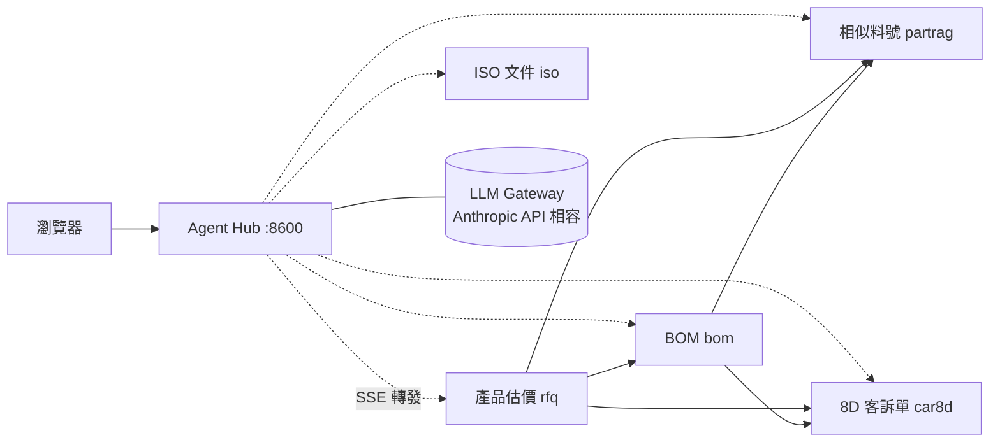

# Agent Hub

多個 RAG／LLM Agent 的**統一前端**與 **Agent-to-Agent（A2A）協作框架**。

各 Agent 是獨立運作的服務（各自的資料庫、各自的程式），Agent Hub 把它們接成同一個對話介面，
並讓它們能在回答問題時互相呼叫：例如「產品估價 Agent」在報價前自動去問「客訴單 Agent」這顆料有沒有品質紀錄。

本 repo 包含兩個部分：

| 部分 | 說明 |
|---|---|
| **Agent Hub**（`main.py`、`static/`） | 統一前端、對話保存、訊息轉發、健康狀態與用量統計 |
| **agentkit**（`agentkit/`） | 共用的 A2A 契約套件：任何 FastAPI 服務掛上它就成為一個可被 Hub 與其他 Agent 呼叫的 Agent |

> 下游的各個 Agent 是獨立專案，不在本 repo 內。沒有啟動任何 Agent 時，Hub 仍可正常開啟，各 Agent 會顯示為「未啟動」。

## 串接的五個 Agent

每個 Agent 都是一個獨立的 RAG 專案，資料來自公司的 PLM 系統（Aras）。點「概覽」可看各專案的完整介紹。

| Agent | 解決什麼問題 | 可以這樣問 | 概覽 |
|---|---|---|---|
| 產品估價 `rfq` | 從歷史詢價單找參考報價與成本 | 「這個規格以前大概多少錢？」 | [概覽][rfq-overview] |
| BOM `bom` | 即時展開產品用了哪些材料 | 「這顆料底下有哪些半成品？」 | [概覽][bom-overview] |
| 相似料號 `partrag` | 用描述找出最接近的線材／連接器料號 | 「PH2.0 2*3P、長 300mm 的線有哪些？」 | [概覽][partrag-overview] |
| 8D 客訴單 `car8d` | 查品質客訴的原因與對策 | 「這顆料被客訴過嗎？根本原因是什麼？」 | [概覽][car8d-overview] |
| ISO 文件 `iso` | 查 ISO 程序文件的內容與出處 | 「留樣品要保存多久？」 | [概覽][iso-overview] |

### 產品估價 Agent（`rfq`）

業務接到客戶詢價時，回答「以前有沒有做過類似的？大概多少錢？」

- **先認出是哪種編號**：詢價單號、產品料號、材料料號各查各的地方，不會把料號當關鍵字亂搜而答非所問
- **讀懂成本分析附件**：從詢價單附的 PDF／Excel 抽出逐項材料單價與人工工時；掃描檔用 OCR，讀不清楚的格子單獨放大重讀
- **估出成本區間**：給新規格一個歷史成本範圍並標示信心等級，高信心的估計有 84% 落在實際成本的 2 倍以內
- **報價前順便查風險**：可詢問 BOM、相似料號、8D 客訴 Agent

規模：5.4 萬筆歷史詢價單 · 技術：PostgreSQL + pgvector、RapidOCR · [完整概覽][rfq-overview]

### BOM Agent（`bom`）

RD 輸入一個料號，立刻看到這個產品**現在**用了哪些材料。

- **多層展開**：一路展開到最底層（最深 12 層），用量逐層相乘並計入損耗
- **半成品與替代料**：標出哪些子件是半成品、每一項有哪些替代料
- **永遠是最新資料**：直接查 PLM、不另存副本；最大的 BOM（1,466 列）展開只要 0.06 秒
- **不會失控**：遞迴深度、列數、失敗次數、下游呼叫都有上限，出錯就停並說明原因，不會無限重試
- **換料前順便查**：可詢問相似料號 Agent 找替代品、詢問 8D 客訴 Agent 確認這顆料有沒有客訴紀錄

技術：SQL Server 遞迴查詢（SQL 檔可直接貼進 SSMS 對答案） · [完整概覽][bom-overview]

### 相似料號 Agent（`partrag`）

在 5.7 萬筆線材與連接器料號中，用口語描述或不完整的編號找到「對的那一顆」。

- **不只靠向量搜尋**：很多料號名稱幾乎一樣、只差規格數字（如 `PH4.2 2*3P` 與 `PH3.0 2*3P`），所以同時用料號、工程圖、PLM 欄位、關鍵字、語意向量等十路檢索，再合併排序
- **規格加權**：pitch、PIN 數與排列、長度、線規命中時加分，把幾乎相同的料號分開
- **查得到工程圖**：同一個編號在廠內、圖面、客戶端寫法不同，用任何一種都能找到正確的那份圖
- **不硬掰**：回答會與資料逐項核對，不符就重寫，仍不符就回「找不到」

成果：136 種問法檢索命中 100%、答案正確率 99.3% · 技術：PostgreSQL + pgvector、BGE-M3、全文檢索 + trigram、RRF · [完整概覽][partrag-overview]

### 8D 客訴單 Agent（`car8d`）

回答「這張單／這顆料／這個客戶過去出過什麼品質問題、原因和對策是什麼」。

- **多種反查**：用客訴單號、料號或客戶查，列出客訴是否成立、負責品保、D3～D8 原因與對策
- **統計分析**：成立率、廠區、客戶、異常類型分布
- **即時查詢**：資料量小（約 300 張單），直接查 PLM 只要 12 毫秒，不需要向量庫，也不會拿到過期資料
- **抓出資料陷阱**：發現 PLM 表單「根本原因」與「臨時對策」兩欄的名稱與內容對調，統一修正並用自動測試把關

技術：SQL Server 直連查詢 · 85 條回歸測試 · [完整概覽][car8d-overview]

### ISO 文件 Agent（`iso`）

問公司 ISO 程序文件的內容，答案附上出處（文件＋頁碼＋條文）。

- **每一頁都查得到**：涵蓋五個廠區的 ISO 文件；掃描頁用 OCR，表格還原成文字，嵌入的流程圖也能讀
- **OCR 會自己學習**：判斷讀得好不好，不好就換設定（例如濾掉紅色印章），並記住每種版型的最佳設定；模擬測試正確率 84.5% → 93.2%
- **看得懂簽核欄**：判斷表單上的簽核格已簽或未簽
- **安全上線**：新索引通過檢查才切換，沒過就繼續用舊版；只需 CPU，資料存在單一 SQLite 檔

技術：SQLite FTS5 + bge-m3、RapidOCR · [完整概覽][iso-overview]

<!--
  各 Agent 概覽連結：把下面的 # 換成實際網址即可（上方表格與各節共用）。
  rfq-overview     → MINI_RAG_3
  bom-overview     → Bom_Agent
  partrag-overview → MINI_RAG_2
  car8d-overview   → 8D客訴單_Agent
  iso-overview     → MINI_RAG_ISO
-->

[rfq-overview]: #
[bom-overview]: #
[partrag-overview]: #
[car8d-overview]: #
[iso-overview]: #

## 功能重點

- **一個前端管全部 Agent**：前端只讀 registry 與各 Agent 的 `/a2a/card`，新增 Agent 不必改前端
- **Agent 互相委派**：結構化工具呼叫（`<agent>__<tool>`）與自然語言轉問（`ask_<agent>`）兩種方式，呼叫圖單向、不會繞回
- **委派需經同意**：「用自己的工具」與「詢問其他 Agent」是兩種獨立授權，未允許時模型既看不到也叫不動下游
- **先給資料、再給答案**：檢索結果一定在呼叫 LLM 之前送到畫面，LLM 故障時仍看得到卡片
- **優雅降級**：下游離線、工具未就緒、LLM 斷線都回結構化狀態，不拋例外、不捏造答案
- **可控的資源**：整題時間預算逐層往下傳、併發與排隊上限、使用者按「停止」會一路取消到 LLM
- **可觀測**：每題耗時、排隊、LLM 呼叫與 token 用量紀錄，附統計總覽頁

## 架構



實線是 Agent 之間的委派方向（定義在 [`agentkit/registry.py`](agentkit/registry.py)）。
只有 Hub 對外開放，各 Agent 只在內部網路被呼叫。詳細設計見 [docs/ARCHITECTURE.md](docs/ARCHITECTURE.md)。

**技術棧**：Python 3.12 · FastAPI · SSE · Anthropic SDK（接 Anthropic 相容的 LLM gateway）· SQLite · 原生 HTML/JS · Docker Compose

## 快速開始

### 本機

```bash
python -m venv .venv
.venv/Scripts/python -m pip install -r requirements.txt     # macOS/Linux: .venv/bin/python
cp .env.example .env                                         # 填入 LLM gateway 的位址、金鑰與模型
.venv/Scripts/python -m uvicorn main:app --host 127.0.0.1 --port 8600
```

開啟 <http://127.0.0.1:8600>（Windows 請用 `127.0.0.1` 而非 `localhost`，避免 IPv6 回退造成每個請求多等約 2 秒）。

各 Agent 預設位址是 `http://127.0.0.1:<registry 中的埠>`，可用環境變數 `A2A_<ID>_URL` 改寫，例如 `A2A_RFQ_URL=http://rfq-host:8300`。

### Docker

```bash
cp .env.example .env
docker network create ragnet            # 第一次才需要
docker compose up --build -d
```

Hub 預設對外埠是 8600（`FRONTEND_PORT` 可改），各 Agent 以容器名稱在 `ragnet` 網路上連線。
部署到伺服器的流程見 [deploy/README.md](deploy/README.md)。

## 把一個服務接成 Agent

1. 在 [`agentkit/registry.py`](agentkit/registry.py) 新增一筆 `AgentRef`（id、埠、上下游），並把它加進要呼叫它的上游的 `downstream`。
2. 在該服務裡宣告 `AgentSpec` 並掛上路由：

```python
from fastapi import FastAPI
from agentkit import AgentSpec, Hit, ToolSpec, build_router, tool_ok

def search(query: str, top_k: int, filters: dict) -> dict:
    return {"query": query, "results": my_db.search(query, top_k)}

def get_item(args: dict) -> dict:
    return tool_ok(my_db.get(args["id"]))      # 失敗用 tool_err()，不要拋例外

SPEC = AgentSpec(
    agent_id="my_agent",                      # 必須存在於 registry
    system="你是……（寫清楚這份資料的範圍與限制）",
    search_fn=search,
    hits_fn=lambda found: [Hit(id=r["id"], title=r["name"], raw=r) for r in found["results"]],
    tools=[ToolSpec(name="get_item", description="用 id 查一筆完整資料",
                    input_schema={"type": "object", "properties": {"id": {"type": "string"}},
                                  "required": ["id"]},
                    handler=get_item)],
    examples=[{"label": "查一筆資料", "prompt": "幫我查 ID-0001"}],
)

app = FastAPI()
app.include_router(build_router(SPEC))       # 提供 /a2a/card、/a2a/search、/a2a/message …
```

3. 重啟 Hub 與所有上游 Agent（registry 是模組層常數，執行中的程序不會重讀）。前端不需要修改。

## 專案結構

```
├── main.py              Hub API：轉發、對話、健康檢查、統計
├── store.py             對話儲存（SQLite、自動備份）
├── metrics.py           統計總覽的彙整
├── agentkit/            A2A 共用契約
│   ├── registry.py      所有 Agent 的 id／埠／上下游
│   ├── server.py        AgentSpec 與 /a2a/* 路由
│   ├── client.py        呼叫其他 Agent（名片、檢索、工具、串流）
│   ├── delegate.py      工具／委派迴圈
│   ├── gateway.py       LLM gateway 客戶端與故障診斷
│   ├── envelope.py      Hit／Block／ToolSpec 與 SSE 事件
│   └── …                期限、併發、取消、遙測、版本檢查
├── static/              前端（對話頁、說明書、統計頁）
├── scripts/             版本檢查、agentkit 打包、鎖定依賴
├── deploy/              git push 式部署腳本
└── tests/               測試（不需要網路、LLM 或任何 Agent）
```

## 測試

```bash
.venv/Scripts/python -m pip install -r requirements-dev.txt
.venv/Scripts/python -m pytest
```

測試使用暫存資料庫與假的下游服務，不會讀寫 `data/`，也不會連線到 LLM。

## 對話備份與還原

對話存在 `data/hub.db`。啟動時與之後每 24 小時自動備份到 `data/backups/`（保留 14 份）。

```bash
python store.py backup                         # 立即備份
python store.py verify data/backups/<檔名>.db  # 驗證備份可用（完整性 + 筆數）
```

還原：停止 Hub → 刪除 `data/hub.db-wal`、`data/hub.db-shm` → 以備份檔覆蓋 `data/hub.db` → 啟動 Hub。

## 主要環境變數

| 變數 | 預設 | 說明 |
|---|---|---|
| `LLM_BASE_URL` / `LLM_API_KEY` / `LLM_MODEL` | — | LLM gateway 連線設定（見 `.env.example`） |
| `A2A_<ID>_URL` | `http://127.0.0.1:<埠>` | 某個 Agent 的位址 |
| `HUB_MESSAGE_BUDGET_S` | 180 | 一題的總時間上限（秒） |
| `HUB_MESSAGE_CONCURRENCY` | 10 | Hub 同時處理幾題 |
| `HUB_DB_PATH` | `data/hub.db` | 對話資料庫位置 |

完整清單見 [docs/ARCHITECTURE.md](docs/ARCHITECTURE.md#環境變數)。
